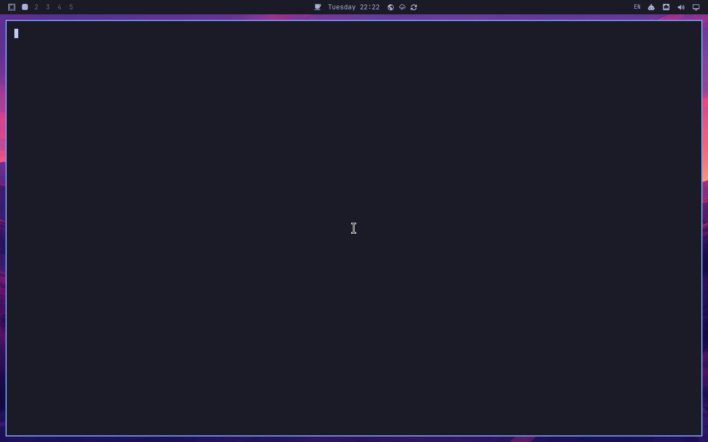

# Omarchy PR15184：独立 ROI 计时通道最终审阅

**计时不确定性未解决，不能报验收通过。** 独立原生 ROI 接口已实现，真实 guest 对照完成：同机全屏 **31.329652ms** → ROI **25.865528ms**，帧间隔缩短 **17.44%**；相对历史全屏30.255190ms缩短 **14.51%**。有收益，但没有达到我在运行前固定的“至少20%”工程门槛；这个门槛不是用户提供的500ms产品要求。按预先计划停止，本轮20次80ms和20次5ms均**未执行**，不改变门槛、不追加随机运行、不声称新一轮计时通过。

本轮模型调用0，费用0。累计保守模型计费仍4.815786元（135个已结算请求，非提供方账单），累计分配90/100元，最后未分配10元未动用。没有新增密钥/付费资源，没有改日用系统，没有改Omarchy产品行为，没有向Omarchy上游评论或合并。Midscene PR保持Draft。

## 版本、环境与准确提交

| 项目 | 实际值 |
|---|---|
| Omarchy candidate | `a1ead6b37605d5f3b63a9ebba2f6a621d6a43b6c`，运行前重新核对未变 |
| 固定历史base | `097c733fc6f24cd437028e0233910b7143fe83f7` |
| 运行前quattro当前值 | `9f49906d22419c45931b92a8816ec852e232c6d6`；未用移动分支代替固定candidate |
| Midscene PR3196最终head | `db131c5cd9e37623db28690a6da6f9418bdacdf6` |
| Midscene PR3196 base | `2aea9bf34ea753e3daf24e64581dd0ac38157bf9` |
| 本轮guest实际SDK | `c59498befd69b23bf88fa31b3283c63c3c47c937`，1.13.3 |
| 两个SDK head的差异 | 最终head仅补齐必填geometry和字节上限的启动前校验及回归测试；原生capture.c完全相同。未声称最终head已在guest重新运行 |
| harness | `adfa187ce6b1876463c6812defa7dd85b9926f52` |
| 真实运行 | [38509094422 / job115673242501](https://github.com/quanru/doubao-say/actions/runs/38509094422)，一次固定试验 |
| 无模型证据恢复 | [38511182034](https://github.com/quanru/doubao-say/actions/runs/38511182034)，只恢复已有归档，不重跑VM |
| 系统 | 公共标准GitHub ubuntu24.04 runner；QEMU/KVM可丢弃完整Omarchy VM；1280×800，scale1，无旋转 |
| guest版本 | Hyprland0.56.2-4，fcitx5 5.1.23-1，configtool5.1.16-2，Quickshell0.3.2-4，内核7.2.8-5-omarchy-bore |

完整 [安装包版本](guest/package-versions.json)、[固定源与构建镜像](versions/source-pins.json)、[实际remote refs](versions/remote-refs.txt)、[native helper hash](versions/native-helper-sha256.txt)、[安装候选完整性](guest/candidate-integrity.json)。1265个安装文件无差异。

## 实现与验证范围

新增 `RegionObservation.start({command,args,geometry,maxFrames})`，这是独立无模型证据接口，不是 Agent DeviceFrameSource；Agent仍用独立全屏截图。每条原生NDJSON同时绑定 PNG、frameId、timing、输出内逻辑坐标、scale、物理输出尺寸及transform。全屏入口拒绝ROI帧；区域接口对帧序列缺口、geometry/时钟改变、意外EOF、容量溢出拒判，停止后仍保持错误；有效已发出像素可在停止后读取，调用方不能修改内部证据。无效配置在spawn前拒绝。

当前仅支持无旋转、整数缩放、没有裁切越界的区域；不会把未知geometry猜成全屏。用户须核实合成器与输入时钟，接口不自动证明物理显示精度。

**真实guest覆盖的范围**：原生区域producer及六块A/B、三次完整源生命周期、同钟检查。`RegionObservation` 的guest生命周期与Agent HTML原本位于A/B门槛之后，因此本轮未运行；新接口的这些路径只有本地回归覆盖。报告不将原生producer对照冒称全部SDK集成验收通过。

## 实际步骤、结果与原始截图

1. 从固定源码构建/安装完整候选，启动真实Hyprland/fcitx5/Quickshell，确认真实Pinyin已配置，打开foot终端。此时处于EN状态，未执行新一轮中文输入或切换。
2. 构建固定Midscene及原生helper。三次完整源生命周期检查通过，每次停止后guest producer为0。
3. 10000组三点steady_clock/CLOCK_MONOTONIC检查通过。每个原生frame的源纳秒都在request/ready范围，时间记录数值中心误差0ns；这不是纳秒级测量准确度保证。
4. 固定六块，每块3秒，顺序：全屏、ROI、ROI、全屏、全屏、ROI。真实原生区域为`0,0,1280,28`，保留整个顶栏；预先审阅的标签框`1137,0,36,26`在六张首图中RGB像素完全一致。该框可见EN，未误把空白区域当标签。
5. 计算A/B性能。只有这项性能统计排除每块前2张启动帧，原始元数据611帧全部保留；每块保存首张原始PNG，共6张。**没有保存611张全部PNG**，所以这些记录只证明空闲采集性能，不是40个切换窗口。
6. ROI中位间隔必须同时小于同机全屏的80%（25.063722ms）和历史30.255190ms的80%（24.204152ms）。实测25.865528ms，两项均未达到；脚本按预先条件退出，未进入按键/Agent步骤。
7. 自动恢复备份，配置字节一致；fcitx仅在清理时重启。原始归档成功导出并恢复，后续没有追加验收运行。

| 块 | 通道 | 帧数 | 间隔中位ms | 最大间隔ms | 编码中位ms | 原始元数据 | 原始PNG |
|---|---|---:|---:|---:|---:|---|---|
| 0 | native-source | 87 | 31.693112 | 34.521075 | 8.305013 | [JSON](versions/roi-ab-0-native-source.json) | [截图](versions/roi-ab-0-native-source.png) |
| 1 | native-region | 110 | 26.414550 | 27.881742 | 0.565361 | [JSON](versions/roi-ab-1-native-region.json) | [截图](versions/roi-ab-1-native-region.png) |
| 2 | native-region | 121 | 25.209155 | 27.684195 | 0.563384 | [JSON](versions/roi-ab-2-native-region.json) | [截图](versions/roi-ab-2-native-region.png) |
| 3 | native-source | 87 | 31.318088 | 44.495063 | 8.276937 | [JSON](versions/roi-ab-3-native-source.json) | [截图](versions/roi-ab-3-native-source.png) |
| 4 | native-source | 88 | 31.329652 | 34.857753 | 8.272592 | [JSON](versions/roi-ab-4-native-source.json) | [截图](versions/roi-ab-4-native-source.png) |
| 5 | native-region | 118 | 25.865528 | 27.929099 | 0.555261 | [JSON](versions/roi-ab-5-native-region.json) | [截图](versions/roi-ab-5-native-region.png) |

## 为什么 ROI 没有达到门槛

按各块中位数再取中位数，PNG编码8.276937→0.563384ms，源回调到ready约7.150629→1.255935ms；ROI确实降低了编码和读回开销。但是下一请求到源回调等待约14.907629→23.924108ms，ROI的帧间隔仍约25.866ms。不同阶段中位数不能直接相加当成同一帧的精确分解，也不能把空闲块结果推断成变化边界性能。详细每块数据见 [独立复核](independent-roi-ab-verification.json)。

本轮没有新按键窗口，因此不能证明旧的500ms跨界区间有所收窄，也不能凭平均帧率消除历史无法判定。ROI有小幅实测收益，未达到预设性能门槛；不是“实现完全无效”，更不是“验收已经通过”。

## DHH 两项验收的最终状态

| 验收项 | 本轮状态 | 仍然成立的历史证据 |
|---|---|---|
| 应用内切换，顶栏500ms内更新 | 未执行新按键；总体不能报通过 | 上轮80ms主口径16通过/0失败/4无法判定；5ms为17/0/3。上轮keydown有1次明确失败；更早quick01的keydown下界503.975110ms失败仍保留 |
| configtool修改列表，不重启刷新 | 本轮未执行 | 较早38498146309三轮真实GUI通过；后续38503280111添加时误选Wubi Pinyin，检查捕获失败，三轮未完成；不能把两轮拼成新的通过 |
| 本轮ROI性能门槛 | 失败：17.44%同机改善，低于预定20% | 阈值未调低，无额外随机重跑 |
| 恢复 | 通过 | 本轮[restore.json](guest/restore.json)证明备份字节一致，仅清理时重启 |

历史38503280111剩余短按主口径：quick03 457.565625–511.064793ms；quick11 492.662556–535.857204ms；quick18 467.115463–512.833489ms。仍全部无法判定。主口径始终完整按键区间，keydown和keyup辅助分开；不能改成keyup来遮盖keydown失败，也不能用5ms组替代80ms常规组。

## 公开接口与证据的技术边界

本次测量的端点是与已抓取像素关联的 Hyprland 合成器捕获回调。它不是显示器发光时间，也不把 PNG 编码结束或传输到主机时间当成屏幕变化时间。±1µs 仅为数值换算余量；实际采样间隙始终由相邻旧/新帧决定。

区域路径确实缩小底层拷贝范围，而非先截图全屏再裁图：[ScreenshareSession.cpp](https://github.com/hyprwm/Hyprland/blob/v0.56.2/src/managers/screenshare/ScreenshareSession.cpp#L75-L115) 用缩放后的 captureBox 确定 SHARE_REGION 缓冲大小；[ScreenshareFrame.cpp](https://github.com/hyprwm/Hyprland/blob/v0.56.2/src/managers/screenshare/ScreenshareFrame.cpp#L383-L419) 按缓冲尺寸分配 SHM 读回对象。是否缩短实际帧间隔仍以同机固定 A/B 为准。

Hyprland 的 [copy()](https://github.com/hyprwm/Hyprland/blob/v0.56.2/src/managers/screenshare/ScreenshareFrame.cpp#L134-L150) 在 SHM 拷贝前调用 RESULT_TIMESTAMP；[Screencopy.cpp](https://github.com/hyprwm/Hyprland/blob/v0.56.2/src/protocols/Screencopy.cpp#L115-L135) 把该时刻的 steadyNow 发送为 ready 时间。代码自身也区分提交回调和 page flip。因此同时列出源事件区间与更保守的 request→ready 获取包络，不把二者混为物理显示精度。

[wlr-screencopy v3](https://github.com/swaywm/wlr-protocols/blob/master/unstable/wlr-screencopy-unstable-v1.xml) 提供一次请求的像素、ready 时间和可选 damage 范围；它没有补发未采样帧的历史机制，也没有“这个字形第一次变成拼”的事件时间。damage 范围不是字形变化时间。对已经采集、旧帧和新帧之间仍横跨500ms的记录，现有数据不包含进一步二分所需的信息，必须保持无法判定。

[wp_presentation.feedback](https://github.com/wayland-mirror/wayland-protocols/blob/main/stable/presentation-time/presentation-time.xml) 针对指定 wl_surface 的提交；外部截图进程不能因此直接获知另一客户端的顶栏表面哪次提交首次包含目标字形。更深的应用/合成器插桩或表面拥有者协作可以新增证据，但属于不同测量架构，而且不能倒推补全已有窗口。更快或并行采样也可能改善未来覆盖，不能据此声称当前接口对任何未来试验都绝无改进空间。

本轮只执行预先固定样本。若 ROI 后仍跨阈值，就报告剩余区间及各项耗时，在已验证的接口和证据边界收束，不继续随机重跑来取得通过样本。

## 最终 head 回归、真实 CI 与限制

- `pnpm run lint`：通过；`pnpm exec nx build @midscene/computer`：通过。
- `pnpm exec nx test @midscene/computer`：159项，155通过、4按平台/环境跳过、0失败。
- `pnpm exec nx test @midscene/core -- ui-observer observation-frame-selection observation-change-focus`：33通过、0失败。
- 不变的原生C源码以C11 `-Wall -Wextra -Werror`编译通过。详见 [计数](development/local-validation.json)、[Computer日志](development/midscene-roi-final-computer.log)、[Core日志](development/midscene-roi-final-core.log)、[构建](development/midscene-roi-build.log)、[lint](development/midscene-roi-lint.log)。本地模拟传输仅是SDK回归，不冒充真实UI。
- 真正CI：完整VM构建启动成功；SDK/原生预检步骤因性能门槛退出失败；按键与Agent步骤跳过；恢复实际成功，但分析器因无`roi.json`再次退出，导致“Restore and package”步骤也显示失败；证据导出成功。无模型恢复运行成功。
- PR自动AI流程使用`[skip ci]`，当前head没有自动check，不能写CI全绿。独立guest测量和最终head有明确上述差异。
- 独立复核32项原始文件hash、611帧geometry/序号/时间、6张首图尺寸及标签像素、10000时钟样本、1265候选文件，均一致。初始与恢复前quickshell/fcitx/indicator进程身份相同。复核脚本：[verify-roi-ab.py](tools/verify-roi-ab.py)。
- 本轮不存在新Midscene Agent原始HTML：Agent未启动。归档中的 [REVIEW.html](REVIEW.html) 是CI原始汇总页，明确无UI与计时结果，**不是Midscene HTML**。本页中文HTML是离线审阅报告，也不伪称实际Agent报告。

## 单一报告索引：本轮与历史各自的原始材料

本轮材料：六块JSON与截图、原始native trace、环境/时钟/恢复、固定计划、最终head开发验证和独立复核均在本包。[原始归档](https://github.com/quanru/doubao-say/blob/74034310a054d84e537cf7b422557a8dae02fd6b/acceptance/omarchy-15184/evidence/run-38509094422.tar.gz) SHA256 `b8bc39e624ed64e69ad16a99dfbbee17ef2892232bc7f8d1efd35afa52065d24`，476757字节。

| 轮次 | 固定报告与完整包 | 原始HTML和截图位置 |
|---|---|---|
| 38503280111 PNG_FILTER_NONE | [中文报告](https://github.com/quanru/doubao-say/blob/ec0f918885336ea62c4e7255d2b58394ccf34564/acceptance/omarchy-15184/evidence/filter-REVIEW.zh.md) · [完整ZIP](https://github.com/quanru/doubao-say/blob/ec0f918885336ea62c4e7255d2b58394ccf34564/acceptance/omarchy-15184/evidence/filter-review.zip) · [原始tar](https://github.com/quanru/doubao-say/blob/ec0f918885336ea62c4e7255d2b58394ccf34564/acceptance/omarchy-15184/evidence/run-38503280111.tar.gz) | 解压根下`midscene/omarchy-15184-real-desktop.html`；`guest/`截图、`observations/`逐帧 |
| 38498146309 native管道修复 | [中文报告](https://github.com/quanru/doubao-say/blob/ec0f918885336ea62c4e7255d2b58394ccf34564/acceptance/omarchy-15184/evidence/native-REVIEW.zh.md) · [完整ZIP](https://github.com/quanru/doubao-say/blob/ec0f918885336ea62c4e7255d2b58394ccf34564/acceptance/omarchy-15184/evidence/native-review.zip) · [原始tar](https://github.com/quanru/doubao-say/blob/ec0f918885336ea62c4e7255d2b58394ccf34564/acceptance/omarchy-15184/evidence/run-38498146309.tar.gz) | 同名原始Midscene HTML；独立guest截图及40次记录 |
| 38492688288 首次native诊断 | [诊断报告](https://github.com/quanru/doubao-say/blob/ec0f918885336ea62c4e7255d2b58394ccf34564/acceptance/omarchy-15184/evidence/run-38492688288-DIAGNOSTIC.zh.md) · [原始tar](https://github.com/quanru/doubao-say/blob/ec0f918885336ea62c4e7255d2b58394ccf34564/acceptance/omarchy-15184/evidence/run-38492688288.tar.gz) | 保留原始HTML/截图；producer泄漏使其不能作为性能通过证据 |
| 38407307331 grim | [完整ZIP](https://github.com/quanru/doubao-say/blob/ec0f918885336ea62c4e7255d2b58394ccf34564/acceptance/omarchy-15184/evidence/final-review.zip) · [原始tar](https://github.com/quanru/doubao-say/blob/ec0f918885336ea62c4e7255d2b58394ccf34564/acceptance/omarchy-15184/evidence/run-38407307331.tar.gz) | `latest/midscene/omarchy-15184-real-desktop.html`，同根guest截图 |

历史材料未改写。本轮只缩小并量化了采集开销，尚未解决500ms不确定；按既定停止条件收束，不实现更大架构，不要求额外模型费用。剩余阻塞是采样/调度时间以及完整按键口径范围，当前已采公开截图证据无法补回缺失中间帧。
